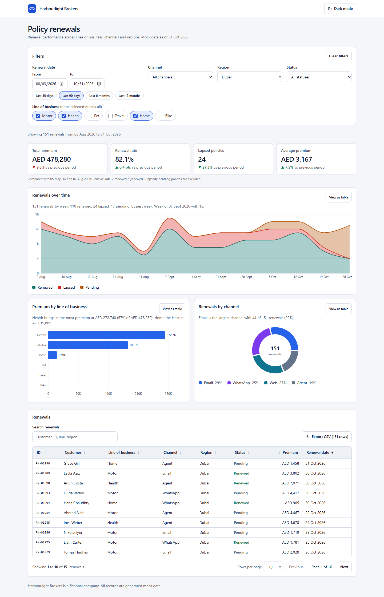
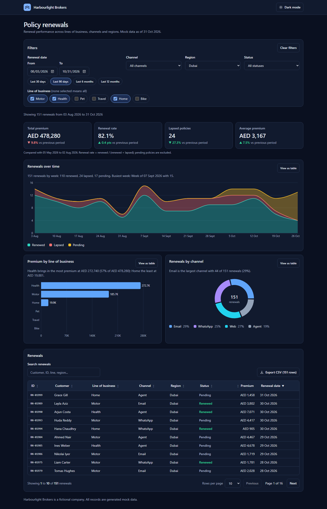
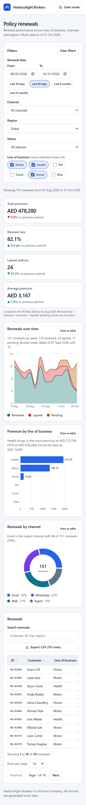
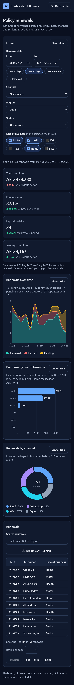
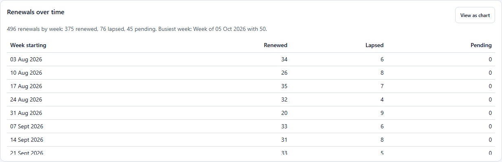

# Policy renewals dashboard

An analytics dashboard for a fictional insurance broker (Harbourlight Brokers): KPIs, charts, URL-driven filters and a sortable, paginated table with CSV export, built on Next.js 16 and React 19 with accessibility and dark mode treated as features, not afterthoughts.



| Desktop, dark | Mobile, light | Mobile, dark |
| --- | --- | --- |
|  |  |  |

Every chart has a text summary and a "View as table" switch:



- Live demo: https://data-dashboard-rose-iota.vercel.app
- GitHub: https://github.com/a4abubakar/data-dashboard

## Features

- **KPI tiles** for total premium, renewal rate, lapsed policies and average premium, each with the change against the previous period of equal length (and an honest "no previous-period data" when that period falls outside the data set).
- **Charts (Recharts):** renewals over time by status (stacked area; day, week or month buckets chosen from the range), premium by line of business (bar), renewals by channel (donut with a text legend).
- **Filters:** date range with presets, line of business (multi-select), channel, region, status. All state lives in the URL, so views are shareable and the back button works. KPIs, charts and table all respond.
- **Data table:** sortable columns with `aria-sort`, pagination with page size, debounced text search, empty state, and CSV export of every filtered row (not just the current page).
- **Real loading and error states:** `loading.tsx` skeletons, `error.tsx` with retry, `not-found.tsx`, an inline retry banner when a request fails, and previous results stay visible (dimmed) while new ones load.
- **Dark mode:** follows the system by default, class-based toggle, persisted, no flash on load.
- **Mock data:** 2,000 deterministic renewal records over 12 months, generated in the repo from a seeded PRNG. Served by a route handler (`/api/renewals`) with an artificial 450 ms delay; nothing leaves your machine.

## Tech stack

Next.js 16.4 (App Router, Cache Components) / React 19 / TypeScript (strict) / Tailwind CSS v4 / Recharts 3 / Vitest 5 + Testing Library / Playwright 1.65.

## Key decisions

- **The URL is the state.** `parseFilters` turns untrusted query params into a valid `Filters` object (bad values fall back to defaults, never throw), and `filtersToSearchParams` omits defaults so URLs stay short. The same parser runs in the route handler and in the browser.
- **Client-side fetching with a route handler.** The page is a static shell; the dashboard reads the URL and fetches `/api/renewals`. That keeps interactions fast (no full navigation per filter click) and gives real loading states. Trade-off: no server-rendered data on first paint. For a real product I would stream the first result from a Server Component and hydrate TanStack Query with it.
- **Optimistic controls.** `useOptimistic` makes checkboxes, selects and sort headers react instantly while the navigation and fetch settle.
- **Pure logic, thin UI.** Filtering, KPIs, grouping, time bucketing, sorting, pagination and CSV live in `src/lib` as plain functions and are unit tested. Components only render.
- **Renewal rate = renewed / (renewed + lapsed).** Pending policies have no outcome yet, so including them would punish recent periods. The definition is printed under the tiles.
- **Dates are ISO strings in UTC** (`YYYY-MM-DD`), so there is no time-zone drift and string comparison is date comparison.
- **Chart accessibility trade-off.** Each SVG is presented as one image described by a summary, and the full data is in the table view. I chose that over Recharts' keyboard layer because a table is a better experience with a screen reader than arrowing through points.
- **Animations off in charts.** Keeps `prefers-reduced-motion` trivially satisfied and screenshots deterministic.
- **CSV safety.** Cells are quoted and anything starting with `=`, `+`, `-` or `@` is prefixed, so an exported file cannot run a formula.

## Project structure

```
src/
  app/                 layout, page, loading, error, not-found, api/renewals/route.ts
  components/          dashboard, filter-bar, kpi-tiles, charts, chart-card,
                       data-table, pagination, table-toolbar, skeletons, theme-toggle
  hooks/               use-filters (URL state), use-renewals (fetch + cancel)
  lib/                 types, generate-data, prng, dates, params, aggregate, table,
                       csv, summaries, renewals-service, store, format
  test/                shared test fixtures
e2e/                   Playwright specs
scripts/screenshots.mjs  regenerates docs/screenshots
```

## How to run

```bash
npm install
npm run dev          # http://localhost:3002
npm test             # Vitest unit and component tests
npm run test:e2e     # Playwright (builds and starts the app on port 3002 if it isn't running)
npm run lint
npm run build
npm run screenshots  # needs the app running on 3002
```

Set `RENEWALS_DELAY_MS=0` to remove the artificial API delay.

The Playwright config and the screenshot script use `channel: "msedge"` (installed Microsoft Edge) because Playwright's bundled Chromium would not launch on the machine this was built on. On CI or any machine where Playwright's own Chromium works, delete that line (`channel: "msedge"` in `playwright.config.ts`, and the `channel` option in `scripts/screenshots.mjs`) and run `npx playwright install chromium`.

## Accessibility notes

- Landmarks (header, main, footer, labelled sections), a skip link, one `h1` and a sensible heading order.
- Every input has a visible label; groups use `fieldset`/`legend`; focus rings are always visible.
- Table headers expose `aria-sort`; sort controls are real buttons; the scrollable table region is focusable so keyboard users can scroll it.
- Results are announced through a polite live region ("Updating results", "Showing N renewals..."); the container sets `aria-busy` while loading, and failures use `role="alert"`.
- Charts never rely on colour alone: titles, text summaries, direct labels and legends with values, plus a table alternative. Chart and UI colours are tokenised for light and dark and picked for at least 3:1 (marks) and 4.5:1 (text) contrast.
- Change indicators pair an arrow and colour with text ("up", "down") for screen readers.
- `prefers-reduced-motion` disables skeleton pulses, spinners and transitions.

## What I'd do next

- Server-render the first result and add TanStack Query for caching and background refresh.
- Run `axe` in the Playwright suite and do a manual screen reader pass (VoiceOver and NVDA).
- Drill-down: click a bar or donut slice to apply it as a filter.
- Saved views, and a custom comparison period (year over year).
- Virtualise the table for very large result sets and stream the CSV.
- Visual regression tests for the charts in both themes.

## Author

**Muhammad Abubaker Siddiq**, Senior Frontend Engineer (React, Next.js, TypeScript)

- GitHub: [@a4abubakar](https://github.com/a4abubakar)
- Portfolio: https://portfolio-next-six-tau.vercel.app
- LinkedIn: https://www.linkedin.com/in/muhammad-abubaker-siddiq-27b37615b
